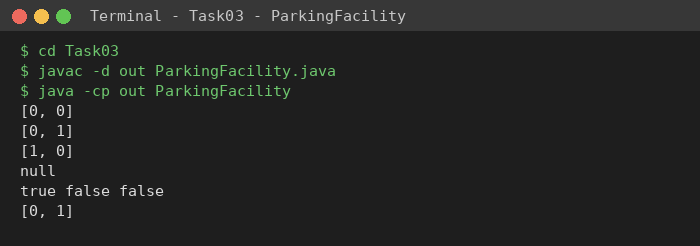
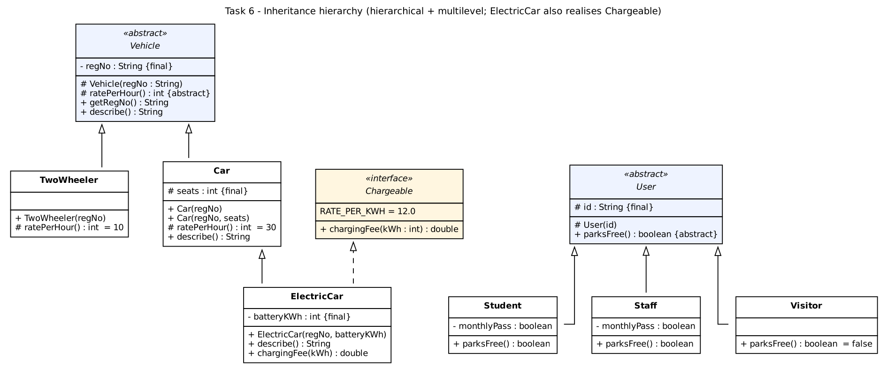
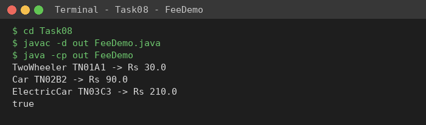
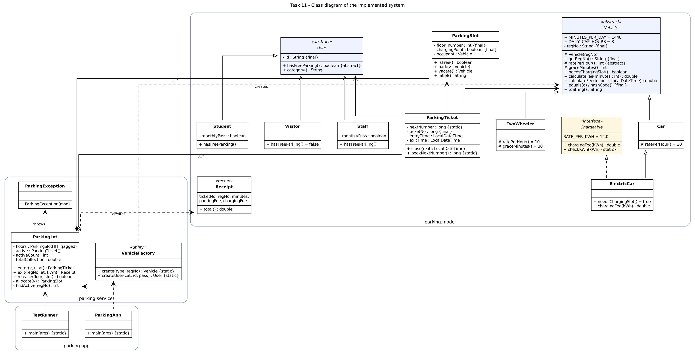
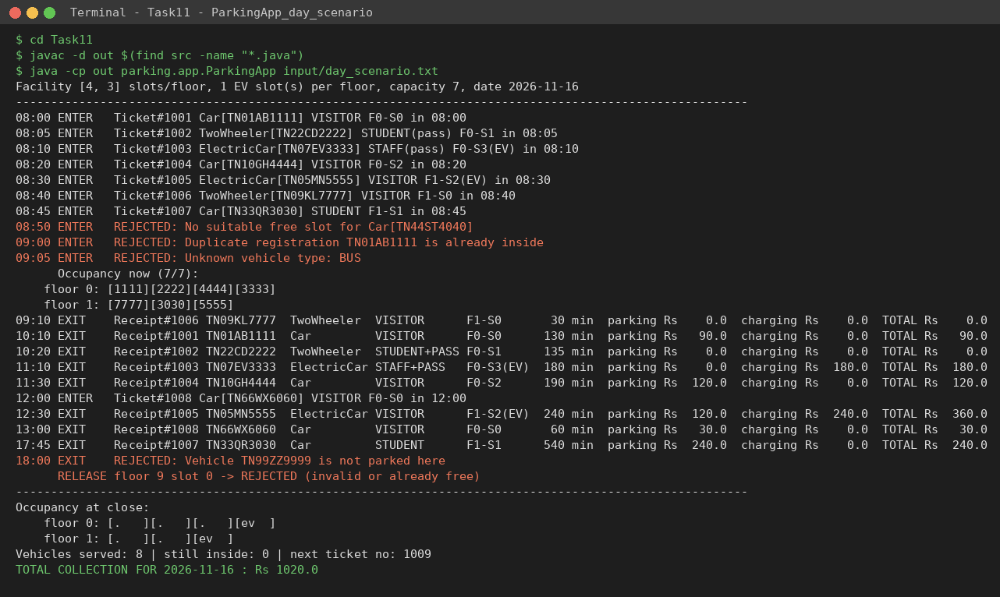
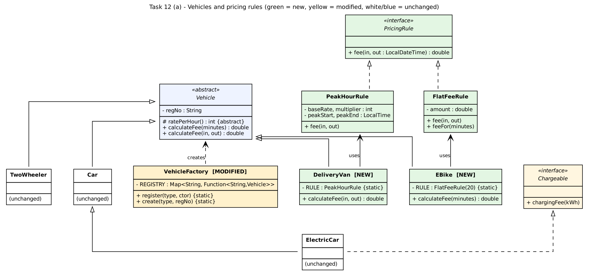
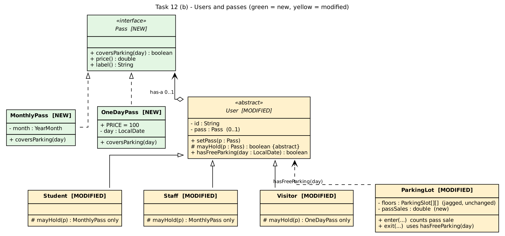
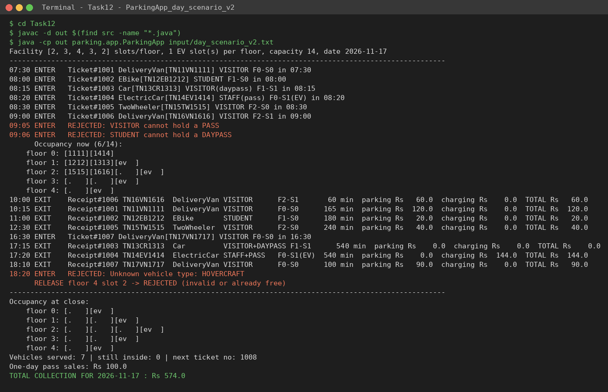

| | |
|---|---|
| **Name** | `<YOUR NAME>` |
| **Register Number** | `<REGISTER NUMBER>` |
| **Course** | CSA09 – Java Programming |
| **GitHub Repository** | `https://github.com/<username>/CSA09-<RegisterNumber>-Assignment1` |
| **Java Version** | OpenJDK 21 (any JDK 17+ compiles the code) |
| **Submission Date** | `<DATE>` |

**Repository layout.** One folder per task (`Task01` … `Task12`). Each folder holds the Java source, its input file(s), `output/*.txt` (console capture, including the compile and run commands) and `screenshots/*.png`. `run_all.sh` compiles and runs every program. All timing figures quoted below come from the output files in the repository; timings vary from machine to machine, so the Big-O trend is what matters, not the exact nanoseconds.

**Fee rules used throughout (stated assumptions).**

| Rule | Value |
|---|---|
| Hourly rate | Two-wheeler Rs 10, Car Rs 30, Electric car Rs 30 |
| Billing unit | Every started hour is charged in full (130 min → 3 h) |
| Zero-minute stay | Rs 0 |
| Grace period | Two-wheelers park free for the first 30 minutes |
| Daily maximum | 8 × hourly rate per 24-hour block (Car: Rs 240) |
| EV charging | Rs 12 per kWh, billed separately; pass holders still pay for energy |
| Monthly pass | Students/staff with a valid pass pay Rs 0 parking; visitors pay the full fee |

\newpage

# Task 1 – Understand the Problem and Identify the Objects

## 1.1 Inputs and outputs

| Inputs the system receives | Outputs it must produce |
|---|---|
| Facility configuration: number of floors, slots per floor, which slots have chargers | Allocated slot (floor, slot) or a "full" rejection |
| Entry event: registration number, vehicle type, user category, pass status, time | Parking ticket with a unique number and entry time |
| Exit event: registration number, time, kWh charged (EVs) | Receipt: duration, parking fee, charging fee, total |
| Attendant actions: release a slot | Occupancy map, day's total collection, error messages |

## 1.2 Nouns → classes, verbs → methods

| Noun in the problem | Candidate class | Why it is needed (justification) |
|---|---|---|
| vehicle, two-wheeler, car, EV | `Vehicle` (abstract) + `TwoWheeler`, `Car`, `ElectricCar` | The fee *depends on the vehicle type*; putting the rate inside each type removes type-testing `if` chains and lets new types be added as subclasses. |
| charging slot / charged separately | `Chargeable` (interface) | Only EVs can be charged; a capability that some (not all) vehicles have is an interface, not a superclass field. |
| student, staff, visitor, monthly pass | `User` (abstract) + `Student`, `Staff`, `Visitor` | Who pays is a rule about the *person*, not the vehicle – the same car may be driven by a visitor today and a staff member tomorrow. |
| slot, floor | `ParkingSlot` (floors = jagged array `ParkingSlot[][]`) | A slot has state (free/occupied, charger) and must enforce "one vehicle per slot". A floor has no behaviour of its own, so it is a row of the array rather than a class. |
| parking ticket, ticket number, entry time | `ParkingTicket` | Links vehicle, user, slot and time; owns the never-reused ticket counter. |
| parking fee / bill | `Receipt` (record) | Immutable result of an exit, easy to print and to total. |
| parking facility | `ParkingLot` | Coordinates everything: allocation, entry, exit, collection. |
| vehicle type typed at the gate | `VehicleFactory` | Converts text input into objects in one place and rejects unknown types. |

| Verb | Method |
|---|---|
| enter / allocate a free slot / issue a ticket | `ParkingLot.enter()`, `allocate()`, `new ParkingTicket()` |
| leave / release the slot | `ParkingLot.exit()`, `ParkingLot.release()`, `ParkingSlot.vacate()` |
| compute the parking fee | `Vehicle.calculateFee()` |
| charge an EV | `Chargeable.chargingFee()` |
| check the pass | `User.hasFreeParking()` |

## 1.3 Responsibilities

* **Vehicle** – knows its registration number and how to price a stay. **Car/TwoWheeler/ElectricCar** – supply the rate and any special rule (grace period, charging slot).
* **User** – knows whether it parks free. **ParkingSlot** – knows if it is free and refuses a second vehicle.
* **ParkingTicket** – records who parked where and when; generates unique numbers. **ParkingLot** – finds slots, issues tickets, closes them, totals the day.

## 1.4 Business rules every valid operation must satisfy

1. A slot holds at most one vehicle (`ParkingSlot.park()` throws if occupied).
2. A ticket number is never reused (static counter only ever increments – test O1: 200 tickets, 200 distinct numbers).
3. A registration number can be inside the facility only once (duplicate entry rejected – test I2).
4. Exit time cannot be before entry time; durations are never negative.
5. Charging slots are reserved for EVs; an EV falls back to a normal slot if no charger is free.
6. Only `Chargeable` vehicles can be billed for energy.
7. Unknown vehicle types and malformed registration numbers are rejected at the gate.

## 1.5 Assumptions

Times are whole minutes; one facility runs on one calendar date per input file; the last *k* slots of each floor have chargers; a visitor cannot hold a monthly pass; fees are in whole rupees except for charging.

## 1.6 Alternative concept – parallel arrays vs objects

**Parallel-array solution** (`Task01/ObjectsVsParallelArrays.java` implements both):

```
String[] regNo, type, entryTime;     // index i describes ONE vehicle
search(key): for i in 0..n-1: if regNo[i].equals(key) return i
add attribute "owner": create String[] owner = new String[n] and update
                      every add / remove / sort routine to move 4 arrays in step
```

| Criterion | Object design `Vehicle[]` | Parallel arrays |
|---|---|---|
| Find by registration | O(n) linear scan | O(n) linear scan |
| Measured (n = 200 000, worst case) | 0.773 ms | 0.654 ms |
| Space per vehicle | 1 array reference + object header (≈12–16 B) + 3 field references | 3 array references (one per array) – no object header |
| Adding an attribute | 1 field in one class | 1 new array + edits in every routine that adds, removes or reorders vehicles |
| Risk | none – data stays together | arrays can get out of step (index i of one array no longer matches i of another) |

Both searches are O(n); the object version is slightly slower because each comparison follows one extra reference (array → object → String). That small constant is outweighed by the design benefit: data and behaviour stay together and a new attribute is a one-line change.

\newpage

# Task 2 – Choose the Data Representation

## 2.1 Data types

| Field | Type | Reason |
|---|---|---|
| floor, slot number | `int` | small whole numbers used as array indexes |
| vehicle number | `String` | alphanumeric (`TN01AB1111`); validated with a regular expression |
| entry / exit time | `java.time.LocalDateTime` | handles crossing midnight and date arithmetic correctly |
| duration | `int` minutes | whole minutes; no rounding error |
| rate | `int` rupees per hour | exact |
| fee | `double` rupees, computed as `int hours × int rate` (+ `12.0 × kWh`) | result is exact because it is built from integers |
| ticket number | `long` | never reused, so it must not overflow quickly |

## 2.2 Floors and slots: jagged array

`String[floor][]` / `ParkingSlot[floor][]` – a **jagged** array, because floors can have different numbers of slots (Task 12 has 2, 3, 4, 3, 2). Each row is created with its own length, and loops use `slots[f].length`, so no space is wasted and no index can fall into a non-existent slot. A rectangular 2-D array would waste memory and accept impossible positions.

## 2.3 Casting risk and its resolution

From `Task02/output/DataRepresentation.txt` (rate Rs 30/h):

| minutes | `(m/60)*rate` (integer division) | `Math.ceil(m/60)*rate` | `(m+59)/60*rate` (used) |
|---|---|---|---|
| 1 | 0 ✗ | 0.0 ✗ | 30 |
| 59 | 0 ✗ | 0.0 ✗ | 30 |
| 61 | 30 ✗ | 30.0 ✗ | 60 |
| 130 | 60 ✗ | 60.0 ✗ | 90 |

* `130 / 60` is **integer division** → 2, so 10 minutes are dropped and the fee is Rs 60 instead of Rs 90.
* `Math.ceil(130 / 60)` looks correct but is still wrong: the division is done in `int` *before* `ceil` sees it.
* `(int)(130 / 60.0)` = 2 – a narrowing cast truncates silently.
* `0.1 + 0.2 = 0.30000000000000004` – fractions of rupees must not be accumulated in `double`.

**Resolution:** billable hours use integer ceiling `(minutes + 59) / 60`, then multiply by the integer rate. No fractional value is ever created, so no precision is lost.

## 2.4 Input

`Scanner` reading standard input (`java DataRepresentation < input.txt`) for Task 2; the larger programs read a text file named on the command line (`args[0]`) with `Files.readAllLines`, so a whole day of events can be replayed and tested repeatedly.

## 2.5 Alternative concept – 1-D array and ArrayList

| Representation | Locate (floor f, slot s) | Space | Different slots per floor? |
|---|---|---|---|
| Jagged `String[F][]` | `slots[f][s]` – O(1) | Σ slots + F row references | natural |
| 1-D `flat[f*S + s]` | O(1) | Σ slots | **breaks** – the program shows `flat[2*20+7] = flat[47] = null` while the car is really at index 77 |
| 1-D with prefix offsets `flat[offset[f] + s]` | O(1) | Σ slots + F ints | works, but `offset[]` must be rebuilt whenever a floor changes |
| `ArrayList<String[]>` | `list.get(f)[s]` – O(1) | Σ slots + F refs + list slack | works; floors can be added at run time |

All give O(1) lookup; the jagged array is the simplest correct one, and the `ArrayList` is only worth it if floors are added while the program runs.

\newpage

# Task 3 – Design the Control Logic

## 3.1 Slot search

Floors are searched in order, and on each floor slots in order. A slot of the wrong kind is skipped with `continue` (EV slots are not offered to petrol cars). The first free slot found is returned immediately with `return`, which ends *both* loops at once – no further slots are examined. If both loops finish, every suitable slot is taken and the method returns `null`; the caller turns that into a "No suitable free slot" rejection and no ticket is issued.

## 3.2 Pseudocode – slot allocation

```
ALGORITHM AllocateSlot
INPUT   : slots[0..F-1][ ]  (jagged array), vehicleNo, needsCharger
OUTPUT  : (floor, slot) of the allocated slot, or NONE if no suitable slot is free
BEGIN
 1.  IF needsCharger = TRUE THEN
 2.      pos ← FindFree(slots, chargerWanted ← TRUE)
 3.      IF pos ≠ NONE THEN
 4.          slots[pos.floor][pos.slot] ← vehicleNo
 5.          RETURN pos
 6.      END IF
 7.  END IF
 8.  pos ← FindFree(slots, chargerWanted ← FALSE)
 9.  IF pos = NONE THEN
10.      DISPLAY "No suitable free slot"
11.      RETURN NONE
12.  END IF
13.  slots[pos.floor][pos.slot] ← vehicleNo
14.  RETURN pos
END

FUNCTION FindFree(slots, chargerWanted)
BEGIN
 1.  FOR f ← 0 TO F-1 DO
 2.      FOR s ← 0 TO length(slots[f]) - 1 DO
 3.          IF hasCharger(f, s) ≠ chargerWanted THEN CONTINUE      // wrong kind
 4.          IF slots[f][s] = EMPTY THEN RETURN (f, s)              // stops both loops
 5.      END FOR
 6.  END FOR
 7.  RETURN NONE
END
```

## 3.3 Pseudocode – fee computation

```
ALGORITHM ComputeFee
INPUT   : vehicleType, minutes, userHasValidPass, kWh
OUTPUT  : fee in rupees, or an error
BEGIN
 1.  SWITCH vehicleType
 2.      CASE TWO_WHEELER        : rate ← 10 ; grace ← 30
 3.      CASE CAR, ELECTRIC_CAR  : rate ← 30 ; grace ← 0
 4.      DEFAULT                 : RETURN ERROR "Unknown vehicle type"
 5.  END SWITCH
 6.  IF minutes < 0 THEN RETURN ERROR "Negative duration"
 7.  IF userHasValidPass = TRUE THEN parking ← 0
 8.  ELSE IF minutes = 0 OR minutes ≤ grace THEN parking ← 0
 9.  ELSE
10.      dailyMax ← 8 × rate
11.      days     ← minutes DIV 1440
12.      rest     ← minutes MOD 1440
13.      hours    ← (rest + 59) DIV 60                 // integer ceiling
14.      IF hours = 0 THEN restFee ← 0
15.      ELSE IF hours = 1 THEN restFee ← rate          // first-hour slab
16.      ELSE restFee ← rate + (hours - 1) × rate       // additional hours
17.      IF restFee > dailyMax THEN restFee ← dailyMax  // daily maximum slab
18.      parking ← days × dailyMax + restFee
19.  END IF
20.  charging ← 0
21.  IF kWh > 0 THEN
22.      IF vehicleType ≠ ELECTRIC_CAR THEN RETURN ERROR "Cannot be charged"
23.      charging ← 12 × kWh
24.  END IF
25.  RETURN parking + charging
END
```

Results of `Task03/FeeSlabCalculator` at every slab edge: 0 min → 0; 1 → 30; 60 → 30; 61 → 60; 420 → 210; 421 → 240 (cap); 600 → 240; 1440 → 240; 1500 → 270; two-wheeler 30 → 0, 31 → 10; `BUS` and `-5` rejected.

## 3.4 Complete the Code – `ParkingFacility`

```java
public int[] allocate(String vehicleNo) {
    for (int f = 0; f < slots.length; f++)
        for (int s = 0; s < slots[f].length; s++)
            if (slots[f][s] == null) { slots[f][s] = vehicleNo; return new int[]{f, s}; }
    return null;
}
public boolean release(int floor, int slot) {
    if (floor < 0 || floor >= slots.length) return false;
    if (slot < 0 || slot >= slots[floor].length) return false;
    if (slots[floor][slot] == null) return false;
    slots[floor][slot] = null;
    return true;
}
```

| Expected output | Actual output (`Task03/output/ParkingFacility.txt`) |
|---|---|
| `[0, 0]` `[0, 1]` `[1, 0]` `null` `true false false` `[0, 1]` | `[0, 0]` `[0, 1]` `[1, 0]` `null` `true false false` `[0, 1]` ✔ identical |

{width=45%}

## 3.5 Alternative concept – free-slot counter + stack

`Task03/FreeStackFacility.java` keeps `freeCount[f]` and a stack `freeStack[f][]` of free slot numbers per floor.

```
allocate: FOR f ← 0 TO F-1: IF freeCount[f] = 0 THEN CONTINUE
                             s ← freeStack[f][--freeCount[f]]  ; occupy ; RETURN (f, s)
          RETURN NONE
release : validate ; clear slot ; freeStack[f][freeCount[f]++] ← s
```

It produces exactly the same output as `ParkingFacility` for the given `main`.

| | Linear scan | Counter + stack |
|---|---|---|
| `allocate()` | O(F × S) worst case | O(F) worst case (skip full floors), O(1) pop |
| `release()` | O(1) | O(1) |
| Extra space | O(1) | O(F × S) ints for the stacks + O(F) counters |
| Measured worst case, 20 × 1000 | 7 447 ns per allocate+release | 43 ns |
| Measured worst case, 5 × 100 | 209 ns | 22.5 ns |

For the 1 × 20 and 3 × 50 facilities the difference is lost in timer noise; the stack only pays off as the facility grows. For the campus sizes in the problem (at most 500 slots) the scan is fast enough and simpler, so it is kept; the stack is the upgrade path.

\newpage

# Task 4 – Classes, Objects and Constructors

## 4.1 Fields and methods

| Class | Fields | Main methods |
|---|---|---|
| `ParkingSlot` | `floor`, `number`, `chargingPoint` (final), `occupiedBy` | `occupy()`, `vacate()`, `isFree()` |
| `ParkingTicket` | `static nextNumber`; final `ticketNo`, `regNo`, `floor`, `slot`, `entryTime`, `duplicate` | getters, `toString()`, `static issue()` |
| `Vehicle` and subclasses, `User` and subclasses | see Tasks 6 and 11 | |

## 4.2 Constructors and chaining (`Task04`)

```java
public ParkingSlot()                          { this(0, 0); }           // default – quick tests
public ParkingSlot(int floor, int number)     { this(floor, number, false); } // normal slot
public ParkingSlot(int floor, int number, boolean charging) { /* validate + assign once */ }

public ParkingTicket(String reg, int f, int s)                     { this(reg, f, s, LocalDateTime.now()); }
public ParkingTicket(String reg, int f, int s, LocalDateTime at)   { this(nextNumber++, reg, f, s, at, false); }
public ParkingTicket(ParkingTicket original)  /* copy constructor */ { this(original.ticketNo, ..., true); }
private ParkingTicket(long no, String reg, int f, int s, LocalDateTime at, boolean dup) { /* validation */ }
```

* **Default** constructor – only where a sensible default exists (a slot at F0-S0 for tests). `ParkingTicket` has *no* default constructor because a ticket with no vehicle is meaningless.
* **Overloaded** constructors – the gate uses "now"; tests and replayed files pass an explicit time.
* **`this`** – separates fields from parameters (`this.floor = floor`) and chains constructors (`this(...)`), so validation is written **once** in the private master constructor.
* **Copy constructor – yes, needed.** When a driver loses a ticket, the duplicate must carry the *same* ticket number and entry time, but be a separate object marked `DUPLICATE`. Output: `original Ticket#1001 … | duplicate Ticket#1001 … (DUPLICATE) | same number? true | same object? false`.

## 4.3 Objects in memory

`ParkingTicket t = new ParkingTicket(...)` – the reference variable `t` lives in the **stack frame** of the method; the object itself lives on the **heap**. `alias = t` copies the reference, not the object (`alias == first → true`). The copy constructor creates a new heap object (`dup == first → false`). Static fields such as `nextNumber` are stored once with the class, not in each object.

## 4.4 Alternative concept – setters or static factory

| Approach | Guarantees a valid object? | Time for n tickets | Space |
|---|---|---|---|
| Overloaded constructors + chaining | **Yes** – the object cannot exist until validation passes | O(n), 1 constructor chain per object | O(n) |
| Default constructor + setters | **No** – `new SetterTicket(); setRegNo(..)` produced `SetterTicket#0 TN05MN5555 F-1-S-1 in null → valid? false` | O(n), 1 + 5 calls per object | O(n); fields cannot be `final` |
| Static factory `ParkingTicket.issue()` | **Yes** – same private constructor; can also be named, cache or return a subclass | O(n) | O(n) |

Measured for n = 1 000 000: constructor 109.7 ms, setters 18.1 ms, factory 104.3 ms. In an earlier run of the same program the order was reversed (constructor 21 ms, setters 116 ms), which shows these numbers are dominated by garbage-collection timing, not by the approach. All three are O(n); the deciding factor is validity, which only the constructor and factory guarantee.

\newpage

# Task 5 – static Members and the Object Life Cycle

## 5.1 Where `static` is needed

| Member | Kind | Why static |
|---|---|---|
| `ParkingTicket.nextNumber` | static variable | one counter for the whole program, so numbers are never repeated |
| `Facility.campusOccupancy` | static variable | total across *all* facility objects |
| `Ticket.issuedSoFar()`, `ParkingTicket.peekNextNumber()` | static method | needs no object; works before any ticket exists |
| `static { nextNumber = 1001; PREFIX = "CMP"; }` | static block | runs once when the class is loaded (output shows it printed exactly once) |
| `VehicleFactory.create()` | static method | a utility with no state |
| `Vehicle.MINUTES_PER_DAY`, `OneDayPass.PRICE` | `static final` constants | shared values, one copy |

**Why an instance counter is wrong** (`Task05/output`): with two gates, each `FacilityWithOwnCounter` starts at 1001, so `CMP1001` is issued at NORTH *and* at SOUTH – ticket numbers are reused. With the static counter the four tickets are 1001–1004.

## 5.2 Life cycle of a ticket after the vehicle leaves

1. `exit()` finds the ticket, closes it and builds a `Receipt` (values copied out).
2. The ticket's slot in `active[]` is overwritten and the last cell set to `null`.
3. No reference to the ticket remains → it is **eligible for garbage collection**. The JVM decides when to reclaim it; `System.gc()` is only a request. In the demo a `WeakReference` showed `null (collected)` after the request.

## 5.3 Passing objects

Java passes *a copy of the reference*. `exit(Ticket t)` can change the object through `t`, but `t = null` inside the method does not affect the caller (output: `after exit(keep): caller's keep still -> CMP1001 …`). Methods return references to new heap objects (`enter()` returns the `Ticket`, `exit()` returns a `Receipt`).

## 5.4 Alternative concept – counter as an instance variable of `ParkingLot`

| Case | Solution | Space for k facilities, n tickets |
|---|---|---|
| static counter in `ParkingTicket` | one global sequence; unique across gates | 1 `long` (8 bytes) – O(1), independent of k and n |
| instance counter, one facility | works | 8 bytes – O(1) |
| instance counter, two facilities (north/south) | numbers clash; must add a prefix (`N-1001`, `S-1001`) or give each facility a disjoint range | k `long`s – O(k), plus a longer ticket id in each of n tickets |

Each ticket stores its own number in both designs (O(n)); the counter is O(1) only when static.

\newpage

# Task 6 – Design the Inheritance Hierarchy

{width=95%}

## 6.1 Hierarchy and inheritance types

* **Hierarchical:** `TwoWheeler` and `Car` both extend `Vehicle`; `Student`, `Staff`, `Visitor` extend `User`.
* **Multilevel:** `Vehicle → Car → ElectricCar` (an electric car *is a* car – same rate, same slot rules).
* **Single** at each link (Java classes have one superclass); `ElectricCar` additionally implements `Chargeable`.

| Class | Inherits | Adds / changes |
|---|---|---|
| `Vehicle` | – | `regNo`, `describe()`, abstract `ratePerHour()` |
| `TwoWheeler` | regNo, describe | rate 10 |
| `Car` | regNo, describe | `seats`, rate 30, extended `describe()` |
| `ElectricCar` | everything in Car | `batteryKWh`, `chargingFee()`, extended `describe()` |

## 6.2 Use of `super`

* **Constructor:** `super(regNo)` in `Car`, `super(regNo, 5)` in `ElectricCar` – must be the first statement.
* **Method:** `ElectricCar.describe()` returns `super.describe() + ", battery=…"` (which itself calls `Vehicle.describe()`).
* **Field:** `super.regNo` reads the protected field inherited from `Vehicle`.

## 6.3 Constructor execution trace – `new ElectricCar("TN07EV3333", 40)`

| Step | What runs (from `Task06/output/InheritanceDemo.txt`) |
|---|---|
| 0 | `ElectricCar(String,int)` called → first statement `super(regNo,5)` → `Car(String,int)` → `super(regNo)` → `Vehicle(String)` → `Object()` |
| 1 | Vehicle instance initialiser block |
| 2 | Vehicle constructor body (`regNo` assigned) |
| 3 | Car instance initialiser block |
| 4 | Car constructor body (`seats = 5`) |
| 5 | ElectricCar instance initialiser block |
| 6 | ElectricCar constructor body (`batteryKWh = 40`) |

Calls go *down* from the subclass, but bodies execute *top-down* from the superclass, so a subclass always sees fully initialised inherited fields.

## 6.4 Alternative concept – composition (`Vehicle` has-a `VehicleType`)

```java
final class VehicleType { final String name; final int ratePerHour; }
final class ComposedVehicle { final String regNo; final VehicleType type;
    int fee(int min) { return (min + 59) / 60 * type.ratePerHour; } }
VehicleType ebike = new VehicleType("E_BIKE", 5);   // new type at run time, no new class
```

| | Inheritance | Composition |
|---|---|---|
| Add a type that differs only in rate | new subclass, recompile | new `VehicleType` object (even from a config file) |
| Add a type with *different behaviour* (grace period, flat fee, peak hours) | override a method in the new subclass | `VehicleType` needs a strategy field or a `switch` → behaviour leaks into one class |
| Time to compute a fee | O(1) – one virtual call | O(1) – one field read |
| Space per vehicle | object header + regNo (+ subclass fields) | object header + regNo + 1 reference to a **shared** `VehicleType` (≈4–8 B extra) |

Inheritance was chosen because the types differ in *behaviour*, not just in a number. Task 12 shows the two are combined in practice: subclasses for new types, composed rule objects for pricing.

\newpage

# Task 7 – Override and Specialise Behaviour

## 7.1 Overridden methods (`Task07/OverridingDemo.java`)

| Method | Overridden in | Why the subclass version is needed |
|---|---|---|
| `ratePerHour()` | `TwoWheeler` (10), `Car` (30) | each type has its own rate |
| `calculateFee(int)` | `TwoWheeler` – first 30 min free, then `super.calculateFee()` | grace rule applies only to two-wheelers |
| `calculateFee(int)` | `ElectricCar` – `super.calculateFee(m) + 12 × kWh` | adds charging on top of the inherited rule |
| `toString()`, `equals()`, `hashCode()` | `Vehicle` | identity is the registration number |

**Rules of overriding** (marked with `@Override`, so the compiler checks them): same name and parameter list; same or covariant return type (`long` instead of `int` would not compile); access may not be weaker (`protected` → package-private would not compile); cannot throw broader checked exceptions; `static`, `private` and `final` methods cannot be overridden. Both illegal cases are left as commented lines in the source.

## 7.2 `final`

| Where | Why |
|---|---|
| `private final String regNo` | a vehicle's identity must never change after construction |
| `public final String getRegNo()` | a subclass must not return a different identity |
| `public static final int MINUTES_PER_HOUR = 60` | constant |
| `static final class ElectricCar` (Task 7) | no further subclassing of a tested leaf class |
| `final equals()/hashCode()` in Task 11 `Vehicle` | a subclass cannot break the equality contract |

## 7.3 `toString()`, `equals()`, `hashCode()`

```java
@Override public boolean equals(Object o) {
    if (this == o) return true;
    if (!(o instanceof Vehicle other)) return false;
    return regNo.equals(other.regNo);
}
@Override public int hashCode() { return regNo.hashCode(); }
```

Output: `a == b : false`, `a.equals(b) : true`, `a.equals(c) : true` (Car vs ElectricCar), equal hash codes, and a `HashSet` keeps only one of the three – so the same registration cannot be inside twice.

## 7.4 Alternative concept – one `calculateFee()` with a `switch`

```java
static double switchFee(String type, int minutes, int kWh) {
    int hours = (minutes + 59) / 60;
    switch (type) {
        case "TWO_WHEELER":  return minutes <= 30 ? 0 : hours * 10.0;
        case "CAR":          return hours * 30.0;
        case "ELECTRIC_CAR": return hours * 30.0 + 12.0 * kWh;
        default: throw new IllegalArgumentException("unknown type " + type);
    }
}
```

| | Overriding | `switch` on type |
|---|---|---|
| Time per fee, k types | O(1) virtual call | O(1) average for a `String` switch (hash then jump); O(k) for an `if–else` chain |
| Measured, k = 3, 3 M calls | 16.8 ns/call | 7.1 ns/call |
| Classes changed to add a type | **0** existing classes (add 1 new subclass) | the `switch` method **and** every other `switch` on type (allocation, display, …) |

Both outputs were identical for all five input vehicles. The `switch` was faster in this micro-benchmark because the JIT inlines a small static method, but the difference is a few nanoseconds per exit; the overriding version wins on maintenance.

\newpage

# Task 8 – Apply Polymorphism

## 8.1 Complete the Code – `FeeDemo`

```java
// TODO 1
int hours = (minutes + 59) / 60;          // integer ceiling, e.g. 130 -> 3
return hours * ratePerHour();
// TODO 2
Car(String regNo) { super(regNo); }
@Override protected double ratePerHour() { return 30; }
// TODO 3
@Override public double chargingFee(int kWh) { return 12.0 * kWh; }
```

| Expected | Actual (`Task08/output/FeeDemo.txt`) |
|---|---|
| TwoWheeler TN01A1 -> Rs 30.0 | TwoWheeler TN01A1 -> Rs 30.0 ✔ |
| Car TN02B2 -> Rs 90.0 | Car TN02B2 -> Rs 90.0 ✔ |
| ElectricCar TN03C3 -> Rs 210.0 | ElectricCar TN03C3 -> Rs 210.0 ✔ |
| true | true ✔ |

{width=45%}

**Why the last line prints `true`.** `equals()` is defined in `Vehicle` and checks only `o instanceof Vehicle && regNo.equals(...)`. An `ElectricCar` *is a* `Vehicle`, and both objects have `TN02B2`, so they are equal even though their classes differ.

**Is this correct for the system?** Yes. A registration number identifies one physical vehicle; two records with the same plate must never be inside at the same time, whatever type was typed at the gate. This is exactly what blocks the duplicate in test I2 (`Car TN09DUP001` then `TwoWheeler TN09DUP001` → rejected). It is also symmetric (`car.equals(ev)` and `ev.equals(car)` are both true), which a `getClass()`-based check would not give between parent and child. The one risk – a subclass redefining equality differently – is removed in Task 11 by making `equals()`/`hashCode()` `final`.

## 8.2 Compile-time polymorphism (overloading)

```java
static double calculateFee(Vehicle v, int minutes)
static double calculateFee(Vehicle v, LocalTime in, LocalTime out)
static double calculateFee(Vehicle v, LocalDateTime in, LocalDateTime out)
```

The compiler chooses the overload from the **number and static types of the arguments**, at compile time. The output shows `calculateFee(ev, 130)` → `(Vehicle,int)`; `calculateFee(ev, 09:00, 11:10)` → `(Vehicle,LocalTime,LocalTime)`, which converts to minutes and delegates; the `LocalDateTime` version handles a stay that crosses midnight (22:00 → 00:10 = 130 min = Rs 90). Task 11's `Vehicle` itself has `calculateFee(int)` and `calculateFee(LocalDateTime, LocalDateTime)`.

## 8.3 Runtime polymorphism – upcasting and dynamic dispatch

`Vehicle[] parked = { new TwoWheeler(..), new Car(..), new ElectricCar(..) }` – each element is **upcast** to `Vehicle`. At `v.calculateFee(130)` the JVM looks at the **actual object** and uses its class's method table:

| reg | Declared type | Actual object | `calculateFee()` executed | `ratePerHour()` executed | fee |
|---|---|---|---|---|---|
| TN01A1 | Vehicle | TwoWheeler | Vehicle.calculateFee | TwoWheeler.ratePerHour | 30.0 |
| TN02B2 | Vehicle | Car | Vehicle.calculateFee | Car.ratePerHour | 90.0 |
| TN03C3 | Vehicle | ElectricCar | Vehicle.calculateFee | **Car.ratePerHour** (inherited) | 90.0 |

**Traced call for TN03C3:** compiler checks `Vehicle` has `calculateFee(int)` ✔ → at run time the object is `ElectricCar` → `ElectricCar` does not override `calculateFee`, so `Vehicle.calculateFee` runs → inside it, `ratePerHour()` is dispatched again on the same object → `ElectricCar` doesn't define it, its superclass `Car` does → returns 30 → 3 × 30 = 90; `FeeDemo` then adds `chargingFee(10)` = 120 via the `Chargeable` interface → 210.

## 8.4 Why this avoids long if–else chains

The loop never asks "what type is this?". A new type (Task 12's `EBike`, `DeliveryVan`) is handled by the same loop without editing it.

## 8.5 Alternative concept – `instanceof` and casting

```java
if (v instanceof ElectricCar) return hours * 30.0;   // must test the most specific type FIRST
else if (v instanceof Car)     return hours * 30.0;
else if (v instanceof TwoWheeler) return hours * 10.0;
throw new IllegalArgumentException("unhandled type");
```

| | Dynamic dispatch | instanceof chain |
|---|---|---|
| Time per call, k types | O(1) method-table lookup | up to k type tests – O(k) |
| Measured, k = 3 | 14.05 ns | 13.29 ns |
| Code size | one line at the call site | k branches, repeated at every place that depends on type |
| Maintenance | new type = new class | every chain must be found and edited; wrong order (`Car` before `ElectricCar`) silently mis-bills |

With only three types the JIT makes the two equally fast; the chain grows linearly with k and every forgotten branch is a bug, which is why dispatch is used.

\newpage

# Task 9 – Introduce Abstraction

## 9.1 Abstract class vs interface

| Element | Choice | Reasoning |
|---|---|---|
| `Vehicle` | **abstract class** | all vehicles share *state* (`regNo`), a *constructor* that validates it, and a concrete fee algorithm. Only the rate is abstract (`protected abstract int ratePerHour()`). It cannot be instantiated – "a vehicle" with no type has no rate. |
| `User` | abstract class | shared `id` + constructor; abstract `hasFreeParking()` |
| `Chargeable` | **interface** | a *capability*, not an identity. An EV is-a Car and can-charge; an e-bike or a future e-van could also charge without being a car. |
| `Payable` | interface | only fee-paying users (visitors) implement it; pass holders do not |
| `Reservable` | interface | a second capability on the same class |

`ElectricCar extends Car implements Chargeable, Reservable` – one superclass gives it identity and state; interfaces give it **multiple behaviours**, which a class could not get from multiple superclasses.

## 9.2 Default and static interface methods

* `default int estimatedChargingMinutes(int kWh, int chargerKW)` – added to `Chargeable` without breaking existing implementers (output: 10 kWh on 22 kW ≈ 28 min).
* `static boolean isValidKWh(int)` – a utility that belongs to the capability; it rejected `500 kWh` in the input file.
* Constant `RATE_PER_KWH = 12.0` (implicitly `public static final`).

## 9.3 Results (`Task09/output/AbstractionDemo.txt`)

| Vehicle | User | min | kWh | Parking | Charging | Total |
|---|---|---|---|---|---|---|
| TN01AB1111 Car | Visitor (Payable) | 130 | 0 | 90 | 0 | 90 |
| TN07EV3333 EV | Visitor | 130 | 10 | 90 | 120 | 210 |
| TN05MN5555 EV | Pass holder | 200 | 20 | 0 | 240 | 240 |
| TN10GH4444 Car | Pass holder | 300 | 0 | 0 | 0 | 0 |
| tn-bad | – | – | – | rejected: bad registration | | |
| TN06PQ6666 EV | – | – | 500 | rejected: kWh 500 | | |

## 9.4 Alternative concept – `Vehicle` as interface, `Chargeable` as abstract class

```java
interface IVehicle { String regNo(); int ratePerHour();
    default double calculateFee(int m) { return (m + 59) / 60 * (double) ratePerHour(); } }
abstract class AbstractChargeable { protected int sessions; double chargingFee(int kWh) {...} }
class AltElectricCar extends AbstractChargeable implements IVehicle { ... }
```

What can no longer be expressed:

* **Constructors / shared validation** – an interface has none; `new AltElectricCar("bad reg!")` was accepted.
* **State** – an interface cannot hold `regNo`; every class must declare its own field and getter.
* **Multiple inheritance** – `AltElectricCar` has spent its one superclass on `AbstractChargeable`, so it can no longer be a `Car`; the car rate is duplicated.
* `protected` abstract members are impossible in an interface (all abstract methods are public).

**Time and space:** a default-method call is an `invokeinterface` and an abstract-class call is `invokevirtual`; after JIT both are O(1) and practically identical. Space per object is unchanged (header + fields); the only difference is that each implementing class repeats the `regNo` field declaration, not more bytes per object.

\newpage

# Task 10 – Enforce Encapsulation through Packages and Access Modifiers

## 10.1 Package structure

```
Task10/src/parking/
├── model/    Vehicle, Car, TwoWheeler, ParkingTicket, PaymentDesk, PublicFieldTicket
├── service/  BillingService
└── app/      Main
```

The same `model / service / app` structure is used for the full system in Tasks 11 and 12.

## 10.2 Access modifiers

| Member | Modifier | Reason |
|---|---|---|
| all data fields (`regNo`, `floor`, `slot`, `durationMinutes`, `paid`) | `private` | only the owning class may change them, through validation |
| `ParkingTicket.counter` | `private static` | nobody can reset the ticket sequence |
| `Vehicle(String)` constructor, `ratePerHour()` | `protected` | only subclasses construct a vehicle / supply a rate |
| `ParkingTicket.markPaid()` | default (package-private) | only `parking.model.PaymentDesk` may mark a ticket paid; `app` cannot (commented line would not compile) |
| `BillingService.billableHours()` | `private` | internal helper |
| getters, `setPosition()`, `setDurationMinutes()`, `MAX_FLOORS` | `public` | the safe interface other packages use |

## 10.3 Validating setters (results)

| Input line | Result |
|---|---|
| TN01AB1111 CAR F0 S5 130 min | OK, Rs 90 |
| TN22CD2222 TWO_WHEELER F2 S99 75 min | OK, Rs 20 |
| floor 5 | REJECTED – Invalid floor 5 (0..4) |
| slot 100 | REJECTED – Invalid slot 100 (0..99) |
| −15 min | REJECTED – Duration cannot be negative |
| `tn09-bad` | REJECTED – Invalid registration number |

## 10.4 Wrapper classes and autoboxing

Autoboxing happens when an `int` is put into a collection or an `Integer` variable (e.g. `Map<String,Integer>` of slot numbers). Risks shown by the program: `Integer 100 == 100 → true` (cached −128…127) but `Integer 500 == 500 → false` (two objects) – values must be compared with `equals()`; unboxing a `null` `Integer` throws `NullPointerException`. The model therefore uses primitive `int` for fields.

## 10.5 Alternative concept – public fields, caller validates

`PublicFieldTicket` accepted `floor = 9, slot = −3, duration = −120`, giving a fee of **Rs −30** (silent corruption).

| | Private fields + validating setter | Public fields |
|---|---|---|
| Cost of validation per update | O(1) – a few comparisons | O(1) **if** the caller remembers |
| Places the check must be written | **1** (the setter) | every place that writes the field: gate entry, attendant correction, file import, tests … – *m* places, each a chance to forget |
| Changing a rule (e.g. 5 → 7 floors) | edit 1 line | find and edit all *m* copies |

\newpage

# Task 11 – Implement, Test and Defend the Design

{width=100%}

## 11.1 Implementation summary (`Task11/src`)

18 classes in three packages. `ParkingLot` keeps floors as a jagged `ParkingSlot[][]`, active tickets in a `ParkingTicket[]` (compacted: removal moves the last ticket into the hole, O(1)), and checks everything *before* changing state (a rejected exit leaves the ticket open – test I11; this ordering was a bug found by testing and fixed). `ParkingApp` replays a day of gate events from `input/day_scenario.txt`; `TestRunner` runs 37 automated tests; `TicketStoreBenchmark` compares ticket stores.

## 11.2 Test table (`Task11/output/TestRunner.txt`, full text in `test_results.csv`)

| ID | Type | Test case | Expected | Actual | Result |
|---|---|---|---|---|---|
| N1 | Normal | Visitor car 130 min | 90.0 | 90.0 | PASS |
| N2 | Normal | Visitor two-wheeler 130 min | 30.0 | 30.0 | PASS |
| N3 | Normal | Visitor EV 130 min + 10 kWh | 210.0 | 210.0 | PASS |
| N4 | Normal | Student with pass, car 130 min | 0.0 | 0.0 | PASS |
| N5 | Normal | Student without pass, car 130 min | 90.0 | 90.0 | PASS |
| N6 | Normal | Staff pass EV 60 min + 5 kWh (energy still paid) | 60.0 | 60.0 | PASS |
| N7 | Normal | Lot empty after all exits | 0 | 0 | PASS |
| B1 | Boundary | Zero-minute stay | 0.0 | 0.0 | PASS |
| B2 | Boundary | Exactly 60 min | 30.0 | 30.0 | PASS |
| B3 | Boundary | 61 min | 60.0 | 60.0 | PASS |
| B4 | Boundary | Two-wheeler exactly 30 min | 0.0 | 0.0 | PASS |
| B5 | Boundary | Two-wheeler 31 min | 10.0 | 10.0 | PASS |
| B6 | Boundary | Car 480 min (daily max) | 240.0 | 240.0 | PASS |
| B7 | Boundary | Car 600 min capped | 240.0 | 240.0 | PASS |
| B8 | Boundary | Car 1500 min (1 day + 1 h) | 270.0 | 270.0 | PASS |
| B9 | Boundary | Last free slot allocated | F1-S0 | F1-S0 | PASS |
| B10 | Boundary | Entry when full | REJECTED: No suitable free slot | same | PASS |
| B11 | Boundary | Freed slot reused | F0-S1 | F0-S1 | PASS |
| B12 | Boundary | EV placed in charging slot | F0-S2(EV) | F0-S2(EV) | PASS |
| B13 | Boundary | Second EV falls back to normal slot | F0-S0 | F0-S0 | PASS |
| B14 | Boundary | Car never takes a charging slot | REJECTED | REJECTED | PASS |
| I1 | Invalid | Unknown vehicle type BUS | REJECTED: Unknown vehicle type | same | PASS |
| I2 | Invalid | Duplicate registration | REJECTED: Duplicate registration | same | PASS |
| I3 | Invalid | Release floor 9 | false | false | PASS |
| I4 | Invalid | Release slot −1 | false | false | PASS |
| I5 | Invalid | Release an already free slot | false | false | PASS |
| I6 | Invalid | Exit of vehicle not parked | REJECTED | REJECTED | PASS |
| I7 | Invalid | Exit before entry | REJECTED | REJECTED | PASS |
| I8 | Invalid | Malformed registration | REJECTED | REJECTED | PASS |
| I9 | Invalid | Negative duration | REJECTED | REJECTED | PASS |
| I10 | Invalid | Charging a petrol car | REJECTED | REJECTED | PASS |
| I11 | Invalid | After a rejected exit the car can still leave | 30.0 | 30.0 | PASS |
| I12 | Invalid | Visitor claiming monthly pass | REJECTED | REJECTED | PASS |
| O1 | Rule | 200 tickets, all numbers unique | 200 | 200 | PASS |
| O2 | Rule | Car vs ElectricCar same reg equal | true | true | PASS |
| O3 | Rule | Equal vehicles, equal hashCode | true | true | PASS |
| D1 | Scenario | Day total vs hand calculation | Rs 1020.0 | Rs 1020.0 | PASS |

**Result: 37 / 37 tests passed.**

## 11.3 Day scenario – hand calculation vs program

Facility: 2 floors with 4 and 3 slots, last slot of each floor has a charger (`input/day_scenario.txt`).

| Vehicle | User | In – Out | Minutes | Hand calculation | Program |
|---|---|---|---|---|---|
| TN09KL7777 two-wheeler | Visitor | 08:40–09:10 | 30 | ≤ 30 min grace → 0 | 0.0 |
| TN01AB1111 car | Visitor | 08:00–10:10 | 130 | ⌈130/60⌉ = 3 × 30 = 90 | 90.0 |
| TN22CD2222 two-wheeler | Student + pass | 08:05–10:20 | 135 | pass → 0 | 0.0 |
| TN07EV3333 EV | Staff + pass, 15 kWh | 08:10–11:10 | 180 | 0 + 15 × 12 = 180 | 180.0 |
| TN10GH4444 car | Visitor | 08:20–11:30 | 190 | 4 × 30 = 120 | 120.0 |
| TN05MN5555 EV | Visitor, 20 kWh | 08:30–12:30 | 240 | 4 × 30 + 20 × 12 = 360 | 360.0 |
| TN66WX6060 car | Visitor | 12:00–13:00 | 60 | exactly 1 h → 30 | 30.0 |
| TN33QR3030 car | Student, no pass | 08:45–17:45 | 540 | 9 × 30 = 270 → cap 240 | 240.0 |
| TN44ST4040 car | – | 08:50 | – | rejected: facility full (last slot taken at 08:45) | rejected |
| TN01AB1111 again | – | 09:00 | – | rejected: duplicate | rejected |
| TN55UV5050 BUS | – | 09:05 | – | rejected: unknown type | rejected |
| **Total** | | | | **0+90+0+180+120+360+30+240 = Rs 1020** | **Rs 1020.0** ✔ |

{width=100%}

## 11.4 Evaluation of the design

* **Encapsulation** – all fields private; state changes only through validated methods (`park()`, `close()`, `setPass()`); `ParkingLot` validates before mutating (test I11). Strong.
* **Inheritance** – vehicle and user hierarchies remove duplicated code: `Car` is 4 lines, `ElectricCar` 10.
* **Polymorphism** – `ParkingLot.exit()` contains no vehicle-type test for pricing; `calculateFee` is dispatched; overloads accept minutes or timestamps.
* **Abstraction** – `Vehicle`/`User` abstract, `Chargeable` an interface; `ParkingLot` depends on these abstractions, not concrete types.
* **Limitation (found from my own code):** the fee rule is written *inside* `Vehicle.calculateFee()` and the pass is a `boolean` inside `Student`/`Staff`. A rule that depends on the time of day, or a pass that is valid only on one date, cannot be added purely by subclassing – which is exactly what Task 12 asks for. Also, `findActive()` is a linear O(n) search (see below), and `VehicleFactory` uses a `switch` that must be edited for every new type.

## 11.5 Alternative concept – array vs ArrayList vs HashMap for active tickets

```java
// ArrayList
for (ParkingTicket t : list) if (t.getVehicle().getRegNo().equals(reg)) { list.remove(t); ... }
// HashMap keyed by registration number
ParkingTicket t = map.remove(reg);  if (t == null) throw new ParkingException("not parked");
```

Measured average time to find one ticket on exit (`Task11/output/TicketStoreBenchmark.txt`):

| n parked | array | ArrayList | HashMap |
|---|---|---|---|
| 100 | 272 ns | 284 ns | 45 ns |
| 1 000 | 2 540 ns | 2 573 ns | 79 ns |
| 10 000 | 21 045 ns | 20 614 ns | 224 ns |
| 100 000 | 441 595 ns | 351 301 ns | 75 ns |

| | Array | ArrayList | HashMap |
|---|---|---|---|
| Find on exit | O(n) | O(n) | O(1) average |
| Remove | O(1) (swap last) | O(n) shift, or O(1) with swap | O(1) |
| Space for n | n references, fixed capacity | n references + up to 50 % slack | n entries (≈32–48 B each) + bucket table ≈ 3–4× the array |

The array and ArrayList grow linearly (×10 parked ≈ ×10 time); the HashMap stays flat. For the largest campus (500 slots) the array costs about 1–1.5 µs per exit – acceptable – so the array is kept in Task 11, and a `HashMap<String, ParkingTicket>` is the recommended change if the facility grows or if the duplicate-entry check (also O(n)) becomes frequent.

\newpage

# Task 12 – Re-evaluate and Adapt the Design (Day-4 Design Challenge)

## A. Impact Analysis

**What has changed:**

1. Two new vehicle categories: **e-bike** (flat fee) and **delivery van** (double the car rate from 09:00 to 17:00).
2. A new pricing rule that depends on the **clock time**, not just the duration.
3. Visitors may buy a **one-day pass** (previously visitors always paid).
4. The facility grows from 3 to **5 floors with a different number of slots on each floor**.

**Affected classes, methods and data structures:**

| Requirement | Affected in the original design | Extend or modify? |
|---|---|---|
| E-bike flat fee | new subclass of `Vehicle`; `VehicleFactory.create()` switch | extend (+1 factory edit) |
| Van peak-hour pricing | `Vehicle.calculateFee(int minutes)` cannot know the time of day; needs `calculateFee(in, out)` | extend – the timestamp overload already existed and was not `final`, so the van can override it |
| One-day pass | `User.hasFreeParking()` had **no date**; `Student`/`Staff` stored a `boolean`; `Visitor` hard-coded `false`; `ParkingLot.exit()` called the no-date method; `VehicleFactory.createUser()` took a boolean | **modify** – a boolean cannot express "valid only on 17 Nov" |
| Pass sales in day total | `ParkingLot` collection | modify (small) |
| 5 floors, different sizes | `ParkingLot.floors` | **none** |

**Why different slot counts affect array design:** a rectangular `String[5][S]` or a flat array indexed `f × S + s` assumes every floor has S slots – it would waste memory and, worse, accept positions that do not exist or compute the wrong index (Task 2 showed `flat[47]` instead of `flat[77]`). My design already used a **jagged array** built from `int[] slotsPerFloor` with loops bounded by `floors[f].length`, so 5 floors of 2, 3, 4, 3, 2 slots work with **no code change** (test X1: capacity 14).

**Classes that had to be modified rather than extended:** `User`, `Student`, `Staff`, `Visitor` (pass model), `ParkingLot` (date-aware pass check, pass revenue), `VehicleFactory` (new type names). The vehicle classes did not change.

## B. Evaluation of the Original Design

* **Can new vehicle types be added only by writing new subclasses?** Almost. `EBike` and `DeliveryVan` are new subclasses and `Vehicle`, `TwoWheeler`, `Car`, `ElectricCar` were not touched. But the type *name* still had to be added to the `switch` in `VehicleFactory` – one modification per new type, which violates the open/closed principle.
* **Are pricing rules spread across many classes or kept in one place?** Spread. The standard slab rule is in `Vehicle`, the grace period in `TwoWheeler`, charging in `ElectricCar`, the pass rule in each `User` subclass. Adding flat and peak-hour pricing the same way would scatter even more logic, and the peak-hour rule would be untestable on its own.
* **Can existing tested classes remain unchanged?** The vehicle hierarchy, `ParkingSlot`, `ParkingTicket`, `Receipt`, `Chargeable` and `ParkingException` – yes. The user hierarchy – no: the boolean pass model is the weak point identified in Task 11.4.

**Conclusion:** the original design is sound for vehicles and storage, but its pass model and the place where pricing lives do not stretch to the new requirements. Neither "retain" (the pass cannot be expressed) nor a full redesign (most of the tested code is still correct) is justified → **MODIFY**.

## C. Adaptation – the revised design

{width=100%}

{width=85%}

(The combined diagram is `report/uml/task12_revised_design.png`.)

**What changed**

1. **New `parking.pricing` package** – `PricingRule` interface (`fee(in, out)`), `FlatFeeRule`, `PeakHourRule`. Rules are objects: they are tested on their own and a new rule is a new class.
2. **`EBike extends Vehicle`** – delegates to `FlatFeeRule(20)`; zero-minute stay is free.
3. **`DeliveryVan extends Vehicle`** – overrides `calculateFee(LocalDateTime in, LocalDateTime out)` and delegates to `PeakHourRule(30, ×2, 09:00, 17:00)`: each started hour is priced at the rate in force at the **start** of that hour.
4. **`Pass` interface** with `MonthlyPass(YearMonth)` and `OneDayPass(LocalDate)` (Rs 100). `User` now **has-a** optional `Pass` (composition) and `hasFreeParking(LocalDate)` asks the pass. Each user type only says which passes it may hold (`mayHold`): students/staff → monthly, visitors → one-day.
5. **`VehicleFactory`** – the `switch` was replaced by a **registry** `Map<String, Function<String, Vehicle>>` with `register(...)`, so the *next* vehicle type needs no edit here.
6. **`ParkingLot`** – checks the pass for the entry date and adds day-pass sales to the collection. The jagged floor array is unchanged.

```java
public final class PeakHourRule implements PricingRule {
    public double fee(LocalDateTime in, LocalDateTime out) {
        long hours = (PricingRule.minutes(in, out) + 59) / 60;
        double total = 0;
        for (long h = 0; h < hours; h++) {
            LocalTime start = in.plusHours(h).toLocalTime();
            boolean peak = !start.isBefore(peakStart) && start.isBefore(peakEnd);
            total += peak ? baseRate * multiplier : baseRate;
        }
        return total;
    }
}
```

**Assumptions:** e-bike flat fee Rs 20 per visit, including any charging; van has no daily cap; a pass covers the stay if it is valid on the entry date; one-day pass Rs 100 is counted in the day's collection when sold.

## D. Evidence-Based Defence

**1. Number of existing classes that changed** (from `Task12/output/design_diff.txt`, `diff -ru Task11/src Task12/src`):

| | Classes |
|---|---|
| Unchanged (9 of 15 production classes) | `Vehicle`, `TwoWheeler`, `Car`, `ElectricCar`, `Chargeable`, `ParkingSlot`, `ParkingTicket`, `Receipt`, `ParkingException` |
| Modified (6) | `User` (27 changed lines), `Student` (7), `Staff` (7), `Visitor` (5), `VehicleFactory` (68 – rewritten as registry), `ParkingLot` (17) |
| Modified (app/test) | `ParkingApp` (11 – parses `DAYPASS`), `TestRunner` (adapted constructors + 18 new tests) |
| New (8) | `Pass`, `MonthlyPass`, `OneDayPass`, `EBike`, `DeliveryVan`, `PricingRule`, `FlatFeeRule`, `PeakHourRule` |

The **whole vehicle hierarchy was untouched**, which is the evidence that the original inheritance + polymorphism design was correct; the changes are concentrated in the one area Task 11 flagged as weak.

**2. Ease of adding a further vehicle type.** Now: 1 new class + 1 `register()` line, **0 existing classes edited**. Test X17 registers an `E_SCOOTER` type at run time and creates one without modifying any class. Before Task 12 the same change needed a new class + an edit to the factory switch.

**3. Test results for the new categories** (`Task12/output/TestRunner.txt` – **55 / 55 passed**, including all 37 original tests re-run as regression, and the original day scenario still totals Rs 1020):

| ID | Test | Expected | Actual |
|---|---|---|---|
| X1 | 5 floors 2,3,4,3,2 → capacity | 14 | 14 ✔ |
| X2 / X3 / X4 | E-bike 10 min / 600 min / 0 min | 20 / 20 / 0 | 20 / 20 / 0 ✔ |
| X5 | Van 10:00–11:00 (peak) | 60 | 60 ✔ |
| X6 | Van 06:00–08:00 (off-peak) | 60 | 60 ✔ |
| X7 | Van 07:30–10:15 = 30+30+60 | 120 | 120 ✔ |
| X8 | Van 16:30–18:10 = 60+30 | 90 | 90 ✔ |
| X9 / X10 | Hour starting exactly 17:00 / 09:00 | 30 / 60 | 30 / 60 ✔ |
| X11 | Visitor + one-day pass, 540 min | 0 | 0 ✔ |
| X12 | One-day pass for another day | 90 | 90 ✔ |
| X13 | Day-pass sales counted | 200 | 200 ✔ |
| X14 | Student buying a day pass | rejected | rejected ✔ |
| X15 | Last month's monthly pass | 90 | 90 ✔ |
| X16 / X17 | Factory: new types / runtime-registered type | created | created ✔ |
| X18 | New-rules day (hand calc 100+60+120+20+40+0+144+90) | Rs 574 | Rs 574.0 ✔ |

{width=100%}

**4. Trade-offs**

* **Pricing is not yet fully in one place.** New rules live in `parking.pricing`, but the original slab rule stays in `Vehicle` – deliberately, to avoid changing 4 tested classes. The next step would be a `StandardHourlyRule` and moving all vehicles onto rules.
* **`DeliveryVan.calculateFee(int minutes)`** cannot know the time of day, so it charges the peak rate (a safe upper bound). This is a slight Liskov-substitution weakness; `ParkingLot` always uses the timestamp overload, so it does not affect bills.
* **Peak-hour rule cost** is O(h) for h started hours (≤ 24 per day) instead of O(1) – negligible.
* **Composition for passes** costs one extra reference per user but replaced three copies of pass logic with one.
* **Registry factory** loses compile-time checking of type names (a typo is only found at run time, as `HOVERCRAFT` was rejected) in exchange for zero edits per new type.

**Final decision: MODIFY.** The analysis showed the vehicle hierarchy, the jagged-array facility and the ticket model already met the new requirements (0 changes, all 37 regression tests still pass), while the boolean pass model and the factory switch could not. Changing exactly those parts – by introducing the `Pass` and `PricingRule` abstractions and a registry – made the new categories and the one-day pass work (55/55 tests, hand-checked day totals of Rs 1020 and Rs 574) and leaves a design in which the next vehicle type touches no existing class.
